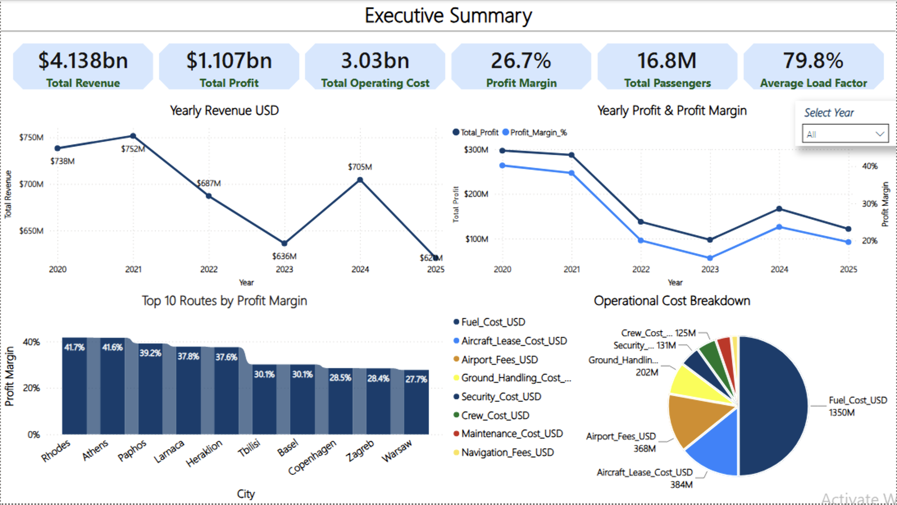

# Airline Analysis | Business Intelligence Project

An end-to-end airline business intelligence project combining **Python, SQL Server and Power BI** to model airline operations and explore financial performance, route profitability, seasonality and operational efficiency.

> **Important — synthetic data:** This is an independent portfolio project built with generated data. It is inspired by the types of business questions an airline such as Sundor might investigate, but it does **not** use Sundor's internal, operational or financial data. The results represent the behavior of this simulation and are not claims about any real airline.

## Project Overview

The project demonstrates how operational data, external factors, market conditions and significant events can be brought together in an analytical model to support business decision-making.

The simulation covers **2020–2025** and represents daily activity across a network of airline routes and destinations. It combines passenger operations and financial performance with contextual factors such as seasonality, holidays, fuel prices, competition and security-related conditions.

The project was built to explore questions such as:

- Which routes generate the most revenue and operating profit?
- How do profitability and profit margin vary between routes?
- How do passenger demand and revenue change throughout the year?
- What is the relationship between route distance, passenger volume and profit per passenger?
- How do fuel costs and other external conditions affect airline profitability?
- How do load factor, flight delays and other operational KPIs vary over time?

## Tools & Technologies

| Tool | Purpose |
|---|---|
| **Python** | Generate the synthetic datasets, apply business logic, prepare data and calculate analytical features |
| **SQL Server** | Create the relational database, load data, join tables and perform business analysis |
| **Power BI** | Build the data model, create DAX measures and present KPIs and interactive reports |
| **Jupyter Notebook** | Develop and document the Python workflow |

## Project Workflow

The project follows an end-to-end workflow:

1. Define the configuration and assumptions used by the simulation.
2. Generate dimension and supporting datasets.
3. Generate external factors and daily route-level operational data.
4. Generate financial performance and operational-event data.
5. Prepare forecasting features and export datasets for SQL Server.
6. Create the SQL Server database, tables and load the generated data.
7. Use SQL queries to investigate business questions.
8. Build a Power BI model and a five-page dashboard to communicate the results.

## Data Model

The central operational dataset is structured at a **daily route level**: each record represents one day of operations for one route or destination.

The model combines descriptive context with measurable activity:

- **Dimensions and reference data:** calendar/date information, routes and destinations, aircraft characteristics, holidays and significant aviation or external events.
- **Operational facts:** passengers, seats offered, flights operated, load factor, delays and operational status.
- **Financial facts:** ticket revenue, ancillary revenue, operating costs and operating profit.
- **External indicators:** demand, fuel, competition and security-risk indices.
- **Forecasting dataset:** historical measures and derived features such as lag values and rolling averages, prepared for forecasting-oriented analysis.

In the SQL Server schema, the core tables include `dim_date`, `dim_route`, `dim_aircraft`, `fact_operations`, `fact_financials` and `forecast_dataset`.

## Business Logic & Simulation Methodology

The generated data is not intended to be a collection of unrelated random values. It is built around defined business assumptions and relationships so that changes in one factor can influence other parts of the simulated airline environment.

### Passenger demand and seasonality

Daily demand is modeled using several inputs:

- Base demand and popularity for each destination
- Seasonal travel patterns
- Israeli holidays and holiday periods
- Security-related conditions and significant events
- Competition levels
- Natural day-to-day variation

The simulation reflects stronger tourism demand during summer and holiday periods, with lower demand during shoulder and off-season periods. These patterns also influence ticket pricing.

### External factors

Three important external indicators are incorporated into the model:

- **Security risk index:** Represents the potential effect of security conditions and significant events on passenger demand, competition and operating costs.
- **Competition index:** Represents the competitive environment on a route. It is influenced by other modeled conditions and affects passenger demand and the airline's pricing power.
- **Fuel index:** Represents changes in fuel-price conditions, a major driver of airline operating costs.

Significant events, including COVID-era disruption and periods of conflict, are represented through the simulation's event assumptions and related indicators. These are modeled scenarios, not a reconstruction of any airline's actual results.

### Passengers and load factor

Passenger volume is based on estimated demand and available seat capacity. The generated passenger count is capped by the seats available through the simulated aircraft and flight schedule.

The load factor is calculated as:

`Load Factor = Passengers / Seats Offered × 100`

The simulation generally produces load-factor values around 80%. This is an outcome of the project's assumptions and generated data, not a verified benchmark for a real airline.

### Revenue model

Revenue consists of two main components:

1. **Ticket revenue:** Ticket prices vary within each route's defined fare range and respond to factors such as demand, load factor, seasonality and holidays.
2. **Ancillary revenue:** Represents additional passenger spending, such as baggage, seat selection and onboard purchases. The simulation assumes higher ancillary revenue per passenger on longer routes.

Fuel prices, security conditions, competition, holidays and seasonality are among the main modeled drivers of airline performance.

## SQL Business Analysis

SQL Server is used to store the generated datasets in a relational structure and perform business-focused analysis.

The analysis script is organized around questions including:

- Executive-level performance KPIs
- Year-over-year revenue, operating cost, profit and margin
- Top routes by total operating profit
- Route profitability and profit margin
- Operating-cost composition and fuel-cost share
- Monthly revenue and profit trends
- Operational KPIs, including load factor and demand
- Route comparisons using passenger volume, delays and profit per passenger

The SQL files are provided in the `SQL/` folder. The analysis script documents the business questions and query approach.

## Power BI Dashboard

The final Power BI report contains five pages:

1. **Executive Summary** — High-level KPIs and an overview of airline performance.
2. **Revenue & Seasonality** — Revenue and passenger trends, monthly patterns and average delay minutes by month.
3. **Cost & Profitability** — Cost and profitability indicators, fuel-cost share over time, and the relationship between route distance and profit per passenger.
4. **Route Performance** — Comparison of route-level performance and profitability.
5. **Operational Performance** — Operational KPIs and performance trends.

### Dashboard Preview

#### 1. Executive Summary



#### 2. Revenue & Seasonality


#### 3. Cost & Profitability


#### 4. Route Performance


#### 5. Operational Performance


## Repository Structure

```text
Airline_Analysis/
├── Images/
│   ├── Executive_Summary.png
│   ├── Revenue & Seasonality.png
│   ├── Cost & Profitability.png
│   ├── Route Performance.png
│   └── Operational Performance.png
├── Power BI/
│   └── Airline_Analysis.pbix
├── Python/
│   ├── 00_config.ipynb
│   ├── 01_generate_dimensions.ipynb
│   ├── 02_generate_external_factors.ipynb
│   ├── 03_generate_operations.ipynb
│   ├── 04_generate_costs.ipynb
│   ├── 05_generate_operational_events.ipynb
│   ├── 06_generate_forecasting_dataset.ipynb
│   ├── 07_analysis_and_kpis.ipynb
│   └── 08_sql_server_export.ipynb
└── SQL/
    ├── 01_database_setup.sql
    ├── 02_create_tables.sql
    ├── 03_data_insert.sql
    └── Business_Analysis.sql
```

## Running the Project

The repository contains the Python notebooks, SQL scripts, Power BI report and dashboard screenshots. The generated CSV data files are not included; they are produced by the Python workflow.

A high-level execution order is:

1. Run the Python notebooks in sequence to generate the datasets.
2. Configure the SQL Server environment and make the generated CSV files accessible to SQL Server.
3. Run `SQL/01_database_setup.sql`, followed by `SQL/02_create_tables.sql` and `SQL/03_data_insert.sql`.
4. Use `SQL/Business_Analysis.sql` to explore the business questions.
5. Open `Power BI/Airline_Analysis.pbix` in Power BI Desktop to explore the report.

**Note:** The data-insertion script uses SQL Server `BULK INSERT` and references CSV files under `/var/opt/mssql/import/`. That path must be available inside the SQL Server environment, and the generated CSV files must be placed there before running the import script. The notebooks and SQL scripts may also require local environment configuration before they can be run on another machine.

## Assumptions & Limitations

- All records and metrics are synthetic and generated for this portfolio project.
- The business rules and relationships are simplified representations designed for analytical practice and demonstration.
- Results illustrate how the model behaves under its assumptions; they are not evidence of actual airline performance.
- A forecasting-oriented dataset and derived features are included in the workflow. The final Power BI report focuses on historical, financial, route and operational analysis rather than presenting a dedicated forecasting page.

## Author

**Idan Artzi** — Aspiring Data Analyst

- [GitHub](https://github.com/IdanArtzi)
- [Portfolio Website](https://idanartzi.github.io/)
